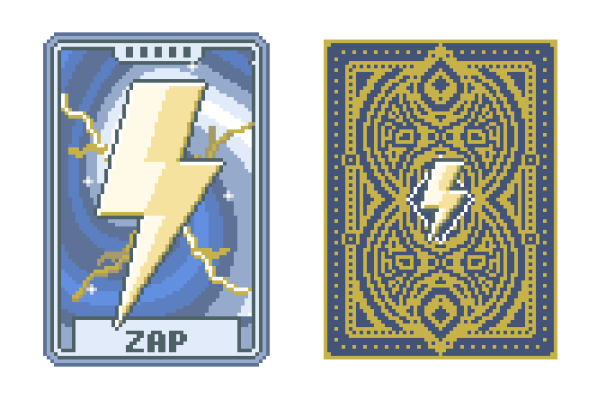

# Mono's Cards

Currently only features a spectral card (Zap) and a deck (Static Deck).

## Zap

> Fuses 2 random Jokers into 1, keeping the abilities of both

Zap has the same odds as The Soul: 0.3% per card in Arcana and Spectral packs, and once per run unless you're holding Showman. You need 2 Jokers to use it.

The fused Joker takes one slot and keeps both abilities. The one that was further left goes first, so fusing Mystic Summit (left) with Cavendish (right) gives +15 Mult and then x3. It acts from the left Joker's slot, which matters for Blueprint, Brainstorm and Ceremonial Dagger. If a Blueprint or Brainstorm in the fusion ends up pointing at its own card, it copies the other Joker instead.

Each half keeps its own Edition, and a Negative half still gives its extra slot. Selling the card pays both sell values. Stickers on either half cover the whole card, with Eternal beating Perishable.

If one half destroys itself (Gros Michel going extinct, Ice Cream melting, Mr. Bones saving you), only that half goes and the other one stays behind as a normal Joker. Selling or destroying the card takes both.

You can see both Jokers on the card. It's split into thin lenticular ridges, and moving your cursor across it flips them from one Joker to the other.

## Static Deck

> Start run with a Zap card

## Installing

Needs [Lovely](https://github.com/ethangreen-dev/lovely-injector) and [Steamodded](https://github.com/Steamodded/smods) 1.0.0~BETA-1620a or newer. Extract the release zip into `%AppData%\Balatro\Mods`, so you end up with `Mods\MonosCards\MonosCards.json`.

Works with [Balatro Multiplayer](https://github.com/Balatro-Multiplayer/BalatroMultiplayer), but everyone in the lobby needs the same mods.
